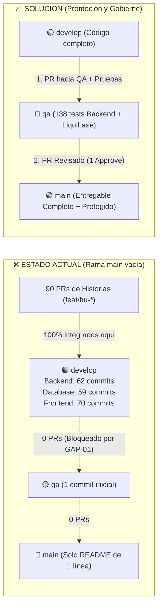
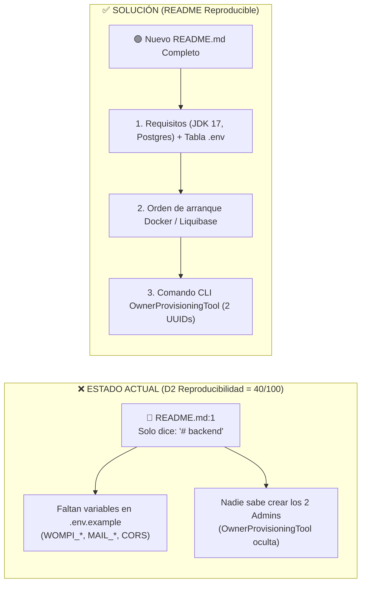

```mermaid
sequenceDiagram
  autonumber
  actor U as Usuario Invitado (App Móvil)
  participant M as Móvil (smart-home-service.ts:217)
  participant B as Backend NestJS (homes.controller.ts:182)

  rect rgb(60, 20, 20)
  Note over U,B: ❌ ANTES (Contrato Roto -> Error 404)
  U->>M: Pulsa botón "Salir del hogar"
  M->>B: POST /api/v1/homes/{id}/leave
  B-->>M: 404 Not Found (Ruta y verbo no existen)
  end

  rect rgb(16, 55, 40)
  Note over U,B: ✅ DESPUÉS (Contrato Alineado -> 200 OK)
  U->>M: Pulsa botón "Salir del hogar"
  M->>B: PATCH /api/v1/homes/{homeId}/members/me/leave
  B-->>M: 200 OK (Miembro retirado del hogar)
  end
```

# 📊 Presentación Ejecutiva: Problema vs. Solución (Planes A, B y C)

Esta presentación reúne las **láminas visuales (infografías PNG)**, los **diagramas de flujo/arquitectura** y el **guion de sustentación** para exponer cada hallazgo junto con su solución técnica.

> [!TIP]
> **Presentación Interactiva en Pantalla Completa:** También tienes lista la presentación web interactiva en [presentacion_exposicion.html](file:///C:/Users/Soy%20yo/.gemini/antigravity/brain/f5912128-ef45-4400-a7b0-0b6bb3625ab4/presentacion_exposicion.html). Puedes abrirla en tu navegador y usar las flechas del teclado (`◀` / `▶`) para pasar las diapositivas.

---

## 🖼️ 1. Carrusel de Láminas Visuales (Imágenes listas para proyectar o pegar en PowerPoint/Canva)

````carousel

<!-- slide -->

<!-- slide -->

````

---

## 🅰️ 2. Plan A — Hallazgo #11 (Alerta Mujer · Equipo 11 · `H-04`)

### Diagrama Visual: Estado Actual vs. Solución Propuesta


### Guion de Exposición (Qué decir en 45 segundos)
* **Qué encontramos:** En los 3 repositorios técnicos de *Alerta Mujer* (`Backend`, `Database` y `Frontend`), la rama principal `main` solo tiene un `README.md` de una línea (`initial commit`), mientras que los **191 commits** del proyecto están atrapados en `develop`.
* **Por qué ocurrió:** En su documento `git-conventions.md` escribieron la regla *"No promover a qa o main sin política aprobada"* y dejaron esa política *"En refinamiento"* durante todo el trimestre (`GAP-01`).
* **Cómo se soluciona:** Crear Pull Requests revisados en cascada (`develop` $\rightarrow$ `qa` $\rightarrow$ `main`) en los 3 repositorios, exigir al menos 1 revisión aprobada y activar *Branch Protection Rules* en `main` para que `git rev-list --count origin/main..origin/develop` sea `0`.

---

## 🅱️ 3. Plan B — Hallazgo #39 (Lava Rápido Vehicular · Equipo 5 · `H-03`)

### Diagrama Visual: Estado Actual vs. Solución Propuesta


### Guion de Exposición (Qué decir en 45 segundos)
* **Qué encontramos:** El repositorio `backend` de *Lava Rápido Vehicular* es un monolito modular en Spring Boot de **15 módulos**, pero su archivo `README.md` tiene literalmente **una sola línea (`# backend`)**.
* **Por qué es grave:** El sistema exige variables críticas de Wompi, SMTP y una regla oculta en `AdminIdentityPolicy.java` que pide exactamente **2 UUIDs de administradores** generados con una herramienta CLI interna (`OwnerProvisioningTool`). Sin un `README`, nadie puede levantar el servidor en una máquina limpia (su puntaje en Reproducibilidad cayó a **40/100**).
* **Cómo se soluciona:** Reescribir `README.md` sincronizado con `.env.example`, documentando prerrequisitos, tabla de variables, orden de arranque con la base de datos y el comando exacto para aprovisionar los dos administradores iniciales.

---

## ©️ 4. Plan C — Hallazgo #67 (SmartHome · Equipo 2 · `H-25`)

### Diagrama Visual: Estado Actual vs. Solución Propuesta


### Guion de Exposición (Qué decir en 45 segundos)
* **Qué encontramos:** En *SmartHome*, cuando un miembro invitado pulsa **"Salir del hogar"** en la App Móvil (`from_movil`), el archivo `smart-home-service.ts` (línea 217) dispara `POST /api/v1/homes/{id}/leave`. Sin embargo, el Backend en NestJS (`homes.controller.ts`, línea 182) escucha en `PATCH /api/v1/homes/:homeId/members/me/leave`.
* **Por qué ocurrió:** Hay una doble ruptura de contrato REST (verbo `POST` vs `PATCH` y omisión de `/members/me`) provocada porque los 10 endpoints del módulo `homes` no estaban documentados en Swagger/OpenAPI (`H-42`).
* **Cómo se soluciona:** Cambiar en la línea 216-217 de `smart-home-service.ts` el método `.post` por `.patch` y la ruta a `/api/v1/homes/${homeId}/members/me/leave`, documentar `@ApiOperation` en el controlador y añadir un test unitario de contrato.
